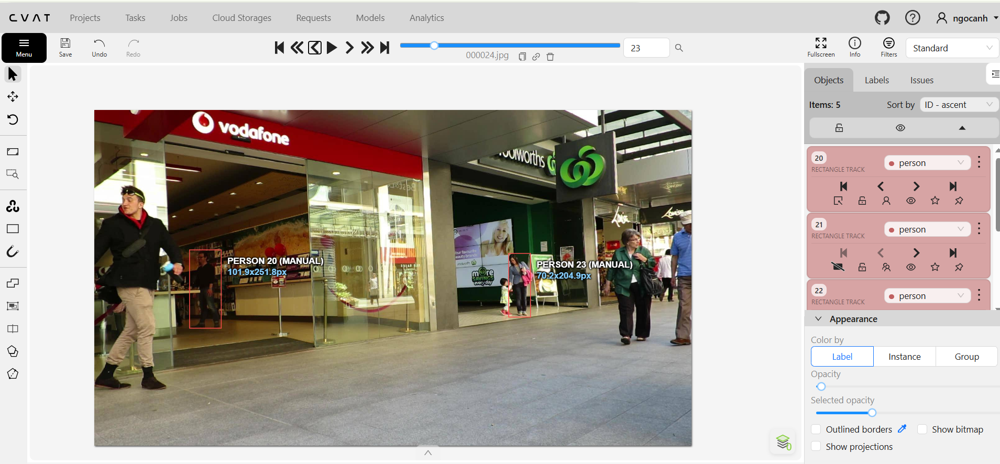
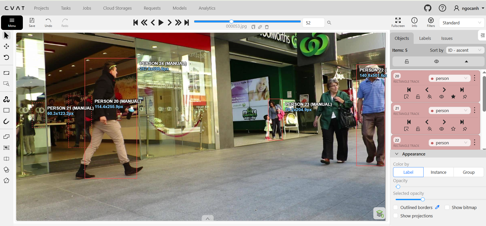
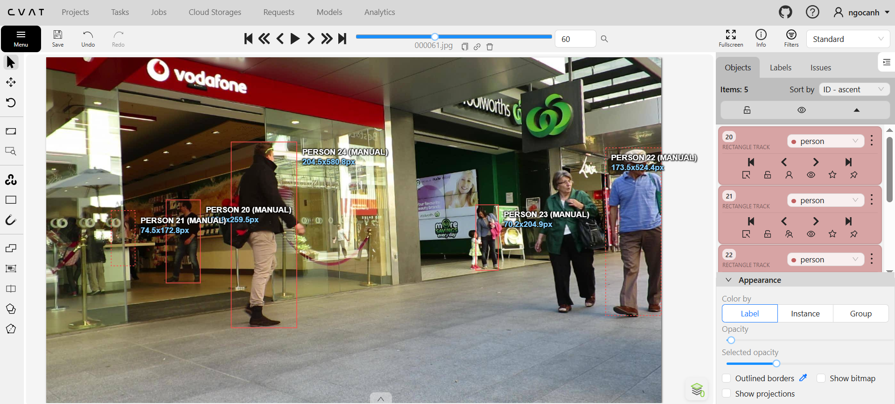

# Báo cáo cá nhân — Trần Thị Ngọc Ánh-2A202603157

## 0. Thông tin học viên

- Họ tên: Trần Thị Ngọc Ánh
- MSSV: 2A202603157
- Mã đề (A/B/C): C
- Email: ngocanh.felicia2003@gmail.com
- Link repository:https://github.com/Ngocanh203/K5-L2-DAY05-Tran-Thi-Ngoc-Anh
- Giờ bắt đầu:16h
- Giờ kết thúc: 19h30

## 1. Xem trước đoạn video (CP0)

Ghi **trước khi vẽ**, mỗi người một dòng.

| Mã | Frame xuất hiện | Frame cuối thấy được | Rẽ / dừng / đổi tốc độ ở frame | Bị che ở frame | Ghi chú |
|---|---|---|---|---|---|
| P1 | 0| 149|	Khoảng 55–90: tiếp tục đi ra phía cửa, hướng dịch chuyển trên ảnh chếch sang phải; chưa thấy dừng hoặc rẽ đột ngột rõ ràng |27–38, 52–54|Che khuất hoàn toàn ở 39–51; cần giữ ID khi hiện lại tại 52 |
| P2 |39 | 149|Khoảng 65–100: đi từ trong cửa hàng ra ngoài, dịch chuyển chếch sang phải trên ảnh; chưa thấy dừng rõ ràng | 39–40, 42–68, 70–78|Bị che một phần nhiều; outside một frame tại 41, cần xem lại ảnh để xác nhận |
| P3 | 39|149 |39–149: đi tương đối liên tục về phía camera, hơi chếch sang trái ảnh; không thấy mốc rẽ hoặc dừng rõ ràng|55–66|Che một phần ở 55–66; kiểm tra khung toàn thân ước lượng |
| P4 |2 |104 |	0–90: đứng hoặc di chuyển rất ít bên cạnh trẻ nhỏ; khoảng 90–110 khó xác định thay đổi chuyển động do bị che |91–102 |Chỉ có 5 keyframe, cần kiểm tra nội suy ở khoảng 41–91 |
| P5 | 27|133 | 	Khoảng 35–45: xoay người theo hướng đi sang phải; khoảng 60–85: chuyển dần từ đi ngang sang đi chếch ra xa camera, quay lưng rõ hơn.|113–117, 128–133|Khuất hoàn toàn ở 118–127; hiện lại tại 128 và outside từ 134 |

## 2. Keyframe và thời gian (CP1, CP4)

Số keyframe lấy từ kết quả `src/check_submission.py`.

| Mã | Số keyframe | Keyframe ở frame | Số frame có mặt | Keyframe / 100 frame | Thời gian (phút) | Chỗ khó |
|---|---|---|---|---|---|---|
| P1 |60 |	0, 3, 11, 13, 14, 15, 16, 17, 18, 19, 20, 22, 27, 29, 30, 31, 32, 33, 34, 35, 36, 37, 38, 52, 55, 56, 57, 58, 59, 61, 63, 66, 71, 72, 75, 77, 84, 88, 89, 91, 96, 97, 99, 102, 105, 110, 111, 113, 114, 116, 118, 120, 122, 127, 129, 131, 137, 141, 144, 149 |137 |43.8 | 30| 	Che khuất hoàn toàn ở 39–51; cần giữ ID khi hiện lại tại 52|
| P2 |45 |39, 42, 43, 44, 45, 46, 47, 48, 49, 69, 70, 71, 74, 79, 81, 84, 85, 87, 91, 93, 96, 97, 99, 100, 101, 103, 104, 109, 110, 112, 117, 121, 123, 125, 126, 128, 129, 132, 137, 139, 141, 144, 147, 148, 149 |110 |40.9 | 25| 	Bị che một phần nhiều; outside một frame tại 41, cần xem lại ảnh để xác nhận|
| P3 |23 |	39, 49, 55, 67, 69, 79, 89, 99, 108, 109, 118, 119, 120, 122, 124, 129, 130, 131, 133, 135, 139, 141, 149| 111| 20.7|15 |	Che một phần ở 55–66; kiểm tra khung toàn thân ước lượng |
| P4 |5 |1, 11, 21, 41, 91 |102 |4.9 | 10| 	Chỉ có 5 keyframe, cần kiểm tra nội suy ở khoảng 41–91|
| P5 |21 |	27, 37, 38, 48, 49, 59, 67, 69, 71, 79, 81, 89, 93, 99, 102, 108, 109, 113, 116, 128, 129|97 |21.6 |20 |	Khuất hoàn toàn ở 118–127; hiện lại tại 128 và outside từ 134 |
| **Tổng** | 154| |557|27,6 | 100|	Giữ ID và kiểm tra nội suy quanh đoạn che |

Keyframe / 100 frame của cả bài = tổng keyframe ÷ tổng số frame có mặt × 100 = 154 ÷ 557 × 100 = 27,6

Tôi đặt keyframe nhiều nhất ở P1, với 60 keyframe. Người này bị che khuất khi người mặc áo đen, quần be đi ngang phía trước, mất hẳn ở frame 39–51 và hiện lại tại frame 52. Tôi tập trung chỉnh khung quanh đoạn che và khi hiện lại để khung bám sát toàn thân, đồng thời giữ đúng ID xuyên suốt

## 3. Đoạn bị che (CP2)

Người bị che: `P1`

| Mốc | Frame |
|---|---:|
| Bắt đầu bị che một phần (bật `occluded`) | 27|
| Mất hẳn (bật `outside`) | 39|
| Hiện lại (tắt `outside`) | 52|
| Thấy rõ trở lại (tắt `occluded`) | 55|

- Thời gian khuất hẳn: 13 frame (39–51) = 0,43 giây.
- Quyết định: giữ cùng ID.
- Lý do (trả lời 3 câu: khuất bao lâu so với 60 frame, ngoại hình có khớp, chỗ hiện lại có đúng hướng và tốc độ):
Lý do:
1. P1 khuất hoàn toàn trong 13 frame, ngắn hơn ngưỡng 60 frame nên giữ track cũ.
2. Khi hiện lại, người mặc áo đen và quần jeans khớp với ngoại hình trước khi bị che.
3. Vị trí hiện lại và chuyển động tiếp tục đi ra phía cửa phù hợp với hướng, tốc độ trước khi bị che, không có dấu hiệu nhảy sang người khác.

Ảnh chụp màn hình:





## 4. Tự review ID (CP3)

Lượt 1 theo người (đi ngược từ frame 149 về 0 trên CVAT), lượt 2 theo cảnh (nhảy 10 frame). Ít nhất 3 dòng; không có lỗi thì ghi một dòng "đã kiểm hai lượt, không lỗi".

Loại lỗi dùng đúng một trong 7 mã: `id_switch`, `fragmentation`, `lost`, `merge`, `false_track`, `drift`, `flag`.

| Frame | Mã người | Loại lỗi | Mô tả một câu | Phát hiện ở lượt | Đã sửa? |
|---:|---|---|---|---|---|
|0 |P5 |lost |	Người mặc áo đen, quần be đã xuất hiện một phần ở mép trái ảnh nhưng track chỉ bắt đầu tại frame 27 |Kiểm tra theo người |Chưa |
|25|P3 |lost |Người mặc áo xanh dương, đội mũ sáng màu đã thấy ở mép phải ảnh nhưng track chỉ bắt đầu tại frame 39 |Kiểm tra theo cảnh |Chưa |
|110 | P4| lost|	Người phụ nữ phía sau cùng trẻ nhỏ vẫn nhìn thấy một phần nhưng track đã bật outside từ frame 103 |Kiểm tra theo cảnh |Chưa |

Tổng hợp số lỗi theo loại:

| `id_switch` | `fragmentation` | `lost` | `merge` | `false_track` | `drift` | `flag` |
|---:|---:|---:|---:|---:|---:|---:|
|0 | 0| 3|0 |0 | 0| 0|

Ở lượt 2, phát hiện P3 đã xuất hiện tại frame 25 nhưng chưa có box và P4 vẫn còn thấy một phần tại frame 110 nhưng track đã bật outside. Khi nhìn toàn cảnh, dễ nhận ra người còn hiện nhưng thiếu nhãn; lượt 1 tập trung theo từng track nên dễ bỏ qua đoạn trước khi track bắt đầu hoặc sau khi box bị ẩn.

## 5. File xuất và kết quả tự kiểm (CP4)

| Kiểm tra | Kết quả |
|---|---|
| Tên file MOT 1.1 | TranThiNgocAnh_mot.zip|
| Tên file CVAT for video 1.1 |TranThiNgocAnh_cvat_video.zip |
| Số track ID khác nhau trong `gt/gt.txt` (phải là 5) | 5|
| Frame `outside` không có dòng trong `gt.txt` (đúng / sai) |Đúng |
| Job đã completed trên CVAT máy cá nhân |Đúng|

Dán phần tóm tắt in ra từ `src/check_submission.py`:

```text
=== Tóm tắt ===
  Lỗi: 0   |   Cảnh báo: 0
  Đạt. Dán phần tóm tắt này vào báo cáo mục 5.
```

## 6. Ba câu kết

1. Nếu được gán lại, bạn sẽ đặt keyframe khác ở đâu? Vì sao?

- Nếu được gán lại, tôi sẽ ưu tiên đặt keyframe sát trước và sau đoạn che khuất, nhất là frame 38 và 52 của track P1. Tôi sẽ giảm các keyframe dư ở đoạn chuyển động đều để tiết kiệm thời gian mà vẫn giữ khung bám sát người.

2. Có chỗ nào bạn không chắc "cùng ID hay ID mới"? Bạn đã quyết định và ghi chú thế nào?

- Đoạn track P1 khuất từ frame 39–51 là vị trí cần cân nhắc giữ ID. Đoạn này dài 13 frame, dưới ngưỡng 60 frame; kết quả xuất cho thấy track được giữ cùng ID khi hiện lại ở frame 52. Cần đối chiếu thêm ngoại hình, hướng và tốc độ để xác nhận quyết định

3. Một lỗi ID trong job của bạn (nếu không còn sót, chọn lỗi đã sửa) có thể làm xe tự lái dự đoán sai chuyển động của người đó như thế nào? Lỗi đó ảnh hưởng MOTA hay IDF1 nhiều hơn?

- Nếu xảy ra lỗi đổi ID giữa hai người, xe tự lái có thể hiểu nhầm một người đột ngột đổi vị trí, từ đó dự đoán sai hướng và tốc độ di chuyển. Lỗi này ảnh hưởng trực tiếp đến IDF1 vì làm mất tính nhất quán danh tính; MOTA cũng bị giảm do tính lỗi ID switch

## 7. Tài liệu tham khảo và công cụ AI đã dùng
- Tài liệu hướng dẫn, checkpoint và yêu cầu nộp bài trong repository K5-L2-MOTTracking.
- CVAT Community để gán nhãn; check_submission.py để tự kiểm file xuất.
- ChatGPT hỗ trợ tìm hiểu tài liệu, giải thích thao tác và trình bày báo cáo.
